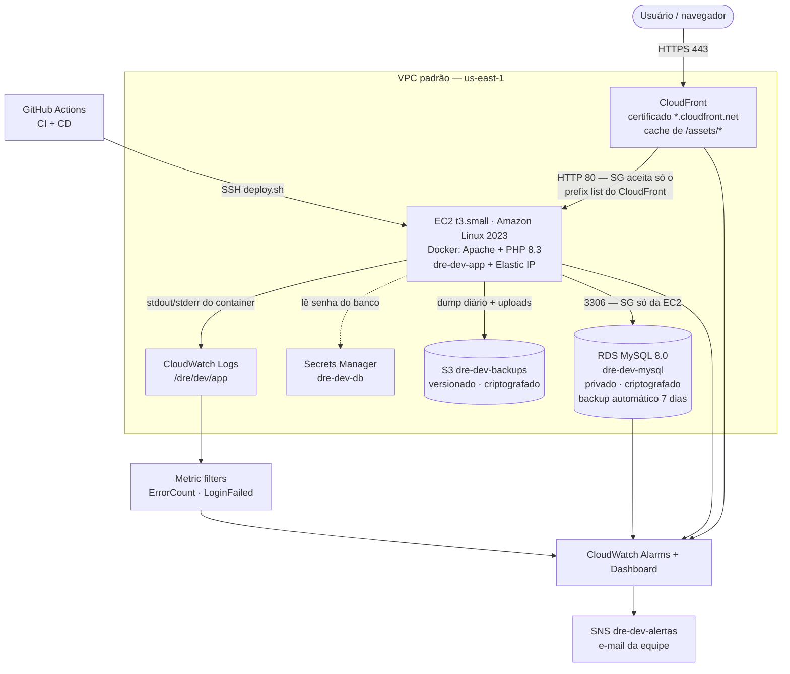

# DRE System — OAF Controle Financeiro (PHP MVC + MySQL)

Sistema de controle financeiro com DRE, fluxo de caixa, calendário de contas, cadastros, importação de planilhas e controle de acesso por usuário.

**Versão 3.3.0 (out/2026)** — aparece na tela de login (constante `APP_VERSION` em `app/bootstrap.php`).

PHP puro, **sem Composer e sem `npm install`**: Excel, PDF e leitura de planilhas são feitos em PHP.

---

## Sumário

1. [Requisitos](#-requisitos)
2. [Como rodar no seu PC com XAMPP (Windows)](#-como-rodar-no-seu-pc-com-xampp-windows)
3. [Como rodar só com o PHP (sem XAMPP)](#-como-rodar-só-com-o-php-sem-xampp)
4. [Como publicar na hospedagem](#-como-publicar-na-hospedagem-hostinger-locaweb-hostgator)
5. [Primeiro acesso](#-primeiro-acesso)
6. [Atualizando da versão 2.x](#-atualizando-da-versão-2x)
7. [Telas](#-telas)
8. [Usuários e níveis de acesso](#-usuários-e-níveis-de-acesso)
9. [Importação de planilhas](#-importação-de-planilhas)
10. [Estrutura MVC](#-estrutura-mvc)
11. [Problemas comuns](#-problemas-comuns)
12. [☁️ AWS — implantação em produção (PI Computação em Nuvem)](#️-aws--implantação-em-produção)

---

## ⚙️ Requisitos

- **PHP 8.0 ou mais novo** (testado no 8.3) com as extensões `pdo_mysql`, `mbstring`, `zip` e `iconv` — no XAMPP já vêm ligadas
- **MySQL 5.7+ / 8.x** ou **MariaDB 10.3+**
- **Apache com `mod_rewrite`** (padrão no XAMPP e nas hospedagens) **ou** nginx

---

## 💻 Como rodar no seu PC com XAMPP (Windows)

1. **Instale o XAMPP** (https://www.apachefriends.org) e abra o **XAMPP Control Panel**.
2. Clique em **Start** no **Apache** e no **MySQL** (os dois ficam verdes).
3. Copie a pasta do projeto para dentro de `C:\xampp\htdocs\`. Exemplo: `C:\xampp\htdocs\DRE-php\`
   (a pasta precisa ter o `index.php`, a pasta `app\`, a pasta `assets\` etc. **direto dentro dela**).
4. Na pasta do projeto, **copie o arquivo `.env.example` e renomeie a cópia para `.env`**.
   Abra o `.env` no Bloco de Notas/VS Code. No XAMPP o padrão é:
   ```ini
   DB_HOST=localhost
   DB_PORT=3306
   DB_USER=root
   DB_PASS=
   DB_NAME=dre_oaf
   APP_ENV=development
   ```
   > O banco `dre_oaf` é **criado sozinho** no primeiro acesso, junto com todas as tabelas. Não precisa importar nada.
5. Abra no navegador: **http://localhost/DRE-php/**
6. Vai aparecer **"Primeiro acesso"** — crie seu usuário. Ele vira o **Administrador**.

> Dica: se o Windows não deixar criar um arquivo chamado `.env`, abra o Bloco de Notas, cole o conteúdo e em "Salvar como" escolha **Todos os arquivos** e digite `.env` com aspas: `".env"`.

---

## 🐘 Como rodar só com o PHP (sem XAMPP)

Precisa do PHP e de um MySQL/MariaDB rodando.

```bash
cd DRE-php
cp .env.example .env        # ajuste DB_USER / DB_PASS / DB_NAME
php -S localhost:8000 router.php
```

Acesse **http://localhost:8000**. O `router.php` faz no servidor embutido o mesmo papel do `.htaccess`.

Quer criar as tabelas antes de abrir o site? `php app/Database/Migrator.php --migrate`

---

## 🌐 Como publicar na hospedagem (Hostinger, Locaweb, HostGator…)

1. No painel da hospedagem, crie um **banco MySQL** e um usuário com acesso a ele. Anote nome do banco, usuário e senha.
2. Envie **todo o conteúdo** da pasta para o `public_html` (ou uma subpasta, ex.: `public_html/dre/` — funciona igual).
3. Crie o `.env` a partir do `.env.example` com os dados do banco e coloque **`APP_ENV=production`** (esconde mensagens técnicas de erro).
4. Garanta permissão de escrita nas pastas **`uploads/`** e **`storage/`** (geralmente já vem; senão `chmod 775`).
5. Acesse o site e faça o **primeiro acesso**.

> Se a hospedagem não deixar o PHP criar o banco, o banco vazio criado no painel já basta — as tabelas são criadas sozinhas. Ou importe o `database.sql` pelo phpMyAdmin.
> Atrás de Cloudflare/proxy? Coloque `TRUST_PROXY=1` no `.env` para o IP certo aparecer nos logs.

### nginx

```nginx
root /var/www/dre;
index index.php;
location ~ ^/(app|storage|docs)/ { deny all; }
location ~ /\.(env|git|ht) { deny all; }
location ~ \.(sql|md|lock|log)$ { deny all; }
location = /router.php { deny all; }
location ~* ^/uploads/.*\.(php\d?|phtml|phar|html?|svg|js)$ { deny all; }
location / { try_files $uri /index.php$is_args$args; }
location = /index.php { include fastcgi_params; fastcgi_param SCRIPT_FILENAME $document_root/index.php; fastcgi_pass unix:/run/php/php8.3-fpm.sock; }
location ~ \.php$ { deny all; }
client_max_body_size 25M;
```

Configuração completa (a mesma usada nos testes de carga) em `docs/nginx.conf.exemplo`.

---

## 🧩 Padrões de projeto

Strategy (regime e agrupamento do DRE), Factory (leitura do XML das notas) e Observer (eventos dos lançamentos), além de MVC, Front Controller e Singleton. Explicação e diagrama de classes em Mermaid em `docs/padroes/`.

## 🧪 Dados fictícios para testar

Gera uma clínica fictícia de jan/2025 a dez/2026: ~2.000 lançamentos (consultas, procedimentos, convênios, aluguel, folha, impostos, materiais…), transferências, 4 contas, clientes e fornecedores com CPF/CNPJ válidos e ~45 notas fiscais com XML e PDF. Tem contas atrasadas de propósito, meses futuros em aberto, um mês com prejuízo e crescimento de 2026 sobre 2025.

```bash
php app/Database/DadosFicticios.php            # gera (só se o banco não tiver lançamentos)
php app/Database/DadosFicticios.php --limpar   # apaga lançamentos, notas, clientes e fornecedores e gera de novo
```

No XAMPP: **XAMPP Control Panel → Shell** → `cd htdocs\DRE-php` → `php app\Database\DadosFicticios.php`.
Usuários de teste: **financeiro / Demo1234** e **consulta / Demo1234** (este vê o aceite LGPD). Se o banco não tinha ninguém, cria também **admin / Admin1234**.

> Use um banco separado pra testar (troque `DB_NAME` no `.env`, ex.: `dre_teste`) — o `--limpar` apaga os dados de movimento.

A auditoria do cálculo (12.680 conferências) está em `docs/testes/AUDITORIA-DRE.md`, com o script pra rodar de novo.

---

## 🔑 Primeiro acesso

- Com o banco vazio, a tela de login mostra **"Primeiro acesso"**: crie o administrador (senha com **8+ caracteres, letras e números**).
- Depois disso o cadastro público some. Novos usuários são criados em **Usuários e acessos**.
- Esqueceu a senha? Um administrador redefine em **Usuários e acessos → ⋮ → Redefinir senha** (gera uma senha provisória, trocada no próximo login). Cada pessoa troca a própria senha em **Meu perfil → Trocar senha**.
- No primeiro acesso de cada pessoa aparece o **Termo de uso e a Política de privacidade (LGPD)** para aceitar. Preencha `LGPD_CONTROLADOR`, `LGPD_CNPJ` e `LGPD_EMAIL` no `.env`.
- Se perder o único admin: rode no banco `UPDATE users SET tentativas_falhas=0, bloqueado_ate=NULL WHERE username='seu_usuario';` (desbloqueio) ou apague todos os usuários (`DELETE FROM users;`) para voltar ao "Primeiro acesso".

---

## 🔁 Atualizando da 3.0 para a 3.1

Substitua os arquivos mantendo `.env`, `uploads/` e `storage/`, e abra o site — o banco atualiza sozinho (tabela de notas fiscais e colunas novas). Depois acrescente no `.env` as linhas novas do `.env.example` (`LGPD_*` e `EMPRESA_CNPJ`). Todo mundo vai aceitar o termo LGPD no próximo login. Relatório dos testes em `docs/testes/RELATORIO-TESTES.md`.

## 🔁 Atualizando da versão 2.x

1. **Faça backup** do banco (phpMyAdmin → Exportar) e da pasta `uploads/`.
2. Substitua os arquivos do sistema pelos desta versão, **mantendo** o seu `.env` e a pasta `uploads/`.
3. Apague o que não existe mais (não quebra nada se ficar, mas fica lixo): `index.html`, `api/`, `css/`, `js/`, `img/`, `app/routes/`, `app/lib/`, `app/schema.php`, `app/router.php`.
4. Abra o site. O banco é atualizado sozinho (colunas novas, tabela de níveis de acesso e de importações). **Nada é apagado.**
   - Quem era **admin** vira nível **Administrador**; quem era **usuário** vira nível **Usuário** (mesmas telas de antes + Calendário).
   - As senhas continuam as mesmas (as antigas, de 6 caracteres, ainda funcionam; só senhas novas exigem 8+).

---

## 🖥️ Telas

| Tela | O que faz |
|---|---|
| **Dashboard** | KPIs do exercício, gráfico receitas × despesas por mês, comparação com o mesmo período do ano anterior, próximos vencimentos (7 dias), saldo por conta e despesas por categoria |
| **DRE** | Demonstrativo mês a mês: receita bruta → deduções (MDR) → receita líquida → despesas → resultado, com **AV%**, **ano anterior** e **AH%**. Agrupa por categoria, grupo/conta ou centro de custo; regime de **competência** ou **caixa**. Exporta Excel e PDF |
| **Calendário** | Contas a pagar e a receber por vencimento. Filtros (a receber / a pagar / vencidos / quitados), totais do mês, **dar baixa** com 1 clique, **nova conta** no dia (duplo clique no dia) |
| **Lançamentos** | Receitas e despesas com filtros, KPIs, baixa/reabrir. Etiqueta **NF** quando tem nota fiscal vinculada |
| **Notas fiscais** | Anexa, visualiza, substitui e remove **PDF e XML**; vincula a lançamento ou conta a pagar/receber; lê o XML (NF-e, NFC-e e NFS-e ABRASF/Nacional) e **preenche o lançamento sozinho** (valor, fornecedor, vencimento das duplicatas, forma de pagamento); importa várias notas de uma vez (até 20 arquivos) |
| **Fluxo de Caixa** | Dia a dia, realizado × previsto, por caixa |
| **Importar / Exportar** | Assistente de importação + Excel, CSV, XML e PDF + histórico com "desfazer" |
| **Clientes, Fornecedores, Parceiros** | Cadastros com CPF/CNPJ validado, busca na Receita (BrasilAPI), contratos e aditivos |
| **Categorias, Caixas/Banco, Formas de pagamento** | Cadastros de apoio (cor da categoria, saldo atual das contas, taxas MDR). Formas de pagamento podem ser **inativadas/reativadas** |
| **Usuários e acessos** | Usuários + níveis de acesso (só administrador) |
| **Logs** | Tudo que foi criado, alterado, apagado, importado, logins (inclusive falhos). Nas exclusões guarda **cópia do que foi apagado** ("Ver apagado") |
| **/termos e /privacidade** | Termo de uso e Política de privacidade (LGPD), abrem sem login |

O menu lateral pode ser **recolhido** (botão `‹` no topo) — o sistema lembra a escolha.

---

## 👥 Usuários e níveis de acesso

**Níveis de acesso** (aba "Níveis de acesso"): para cada tela você escolhe **Sem acesso**, **Ver** (só consulta) ou **Editar** (criar, alterar, apagar). O bloqueio vale no menu **e no servidor** (a API recusa mesmo se alguém tentar chamar direto).

Níveis que já vêm prontos:

| Nível | Para quem |
|---|---|
| **Administrador** | Acesso total + Usuários e acessos. Não pode ser apagado; o sistema nunca fica sem um admin ativo |
| **Usuário** | Dia a dia: lançamentos e cadastros de clientes/fornecedores/parceiros |
| **Financeiro** | Todas as telas financeiras e cadastros, sem gerenciar usuários |
| **Consulta** | Só visualiza, não altera nada |

Dá pra criar quantos níveis quiser (ex.: "Recepção", "Contador"), **duplicar** um existente e ajustar. Ao apagar um nível em uso, o sistema pede para qual nível os usuários vão.

**Usuários:**
- Ao criar, escolha **Gerar senha provisória** (aparece uma vez, pra você passar pra pessoa) ou **Definir agora**. Com senha provisória, no primeiro acesso a pessoa **é obrigada a criar a própria senha**.
- **Desativar** tira o acesso na hora sem apagar o histórico. **Redefinir senha** e **desativar** derrubam a sessão da pessoa imediatamente.
- A lista mostra último acesso (data e IP), quem está bloqueado e quem ainda não fez o primeiro acesso.

**Segurança do login:**
- 5 senhas erradas seguidas **bloqueiam o usuário por 15 min** (admin pode desbloquear antes). 15 erros do mesmo computador em 10 min bloqueiam o IP.
- "Manter conectado" guarda a sessão por 30 dias; sem marcar, a sessão cai ao fechar o navegador ou após 8h parada.
- Token CSRF em todas as ações, cookie `HttpOnly` + `SameSite=Strict` (+ `Secure` em HTTPS), senha com bcrypt.
- Mostrar/ocultar senha, aviso de Caps Lock e medidor de força da senha.

---

## 📥 Importação de planilhas

Em **Importar / Exportar**:

1. **Arquivo** — escolha o que vai importar (**Lançamentos**, **Clientes** ou **Fornecedores**) e envie um `.xlsx` ou `.csv` (até 10 MB / 5.000 linhas). Tem **planilha modelo** pra baixar.
2. **Colunas** — o sistema sugere qual coluna vai em cada campo pelo nome do cabeçalho (Data, Valor, Descrição, Categoria, Situação, Vencimento…). Ajuste se precisar.
3. **Conferir** — prévia linha a linha: **prontas**, **com aviso**, **duplicadas** e **com erro** (erros e duplicadas são puladas).
4. **Pronto** — importa tudo numa transação só. No **histórico** dá pra **desfazer** (apaga só o que aquela importação criou).

O que ele entende sozinho:
- Valores `R$ 1.234,56`, `1234.56`, `-230,45`, `(230,45)`
- Datas `05/04/2026`, `05/04/26`, `2026-04-05` e datas do Excel
- Tipo: Receita/Entrada/Crédito ou Despesa/Saída/Débito. Sem coluna de tipo: **valor negativo = despesa** (ou escolha "tudo despesa" / "tudo receita")
- Situação: Pago/Quitado/Recebido/Sim ou Em aberto/Pendente/Não. Sem coluna: o padrão que você escolher
- Categoria pelo nome; se não existir, cria (se marcar a opção) ou deixa sem categoria
- CSV com `;` ou `,`, em UTF-8 ou ANSI (o padrão do Excel no Brasil)
- Duplicados: mesma data + tipo + valor + descrição (no sistema ou repetido na planilha)

> Arquivo `.xls` antigo (Excel 97-2003) não é lido: no Excel use **Salvar como → Pasta de Trabalho do Excel (.xlsx)**.

---

## 🧱 Estrutura MVC

```
DRE-php/
├── index.php                 ← front controller: toda requisição passa por aqui
├── .htaccess                 ← manda tudo pro index.php e bloqueia app/, storage/, .env
├── router.php                ← o mesmo papel do .htaccess no "php -S"
├── .env.example              ← modelo da configuração (copie para .env)
├── database.sql              ← schema completo (opcional, as tabelas são criadas sozinhas)
├── app/
│   ├── bootstrap.php         ← carrega .env, autoload das classes, constantes
│   ├── helpers.php           ← funções pequenas (e(), url(), validação de CPF/CNPJ…)
│   ├── routes.php            ← TODAS as rotas (páginas e /api/*)
│   ├── Core/                 ← o "framework": App, Router, Request, Response, View,
│   │                            Database, Model, Controller, Auth, Session, Csrf, Permissions
│   ├── Controllers/
│   │   ├── PageController.php        ← entrega as telas (HTML)
│   │   └── Api/*Controller.php       ← JSON: Auth, Dre, Transacao, Cliente, Fornecedor, Parceiro,
│   │                                   Documento, Categoria, Caixa, FormaPagamento, Cadastro,
│   │                                   Usuario, Perfil, Log, Export, Importacao
│   ├── Models/               ← um por tabela, com o SQL e as validações
│   │                            (User, Perfil, Transacao, Transferencia, Cliente, Fornecedor, Parceiro,
│   │                             Documento, Categoria, Caixa, FormaPagamento, Cadastro, Importacao, Log, RateLimit)
│   ├── Services/             ← regras maiores: DreService (cálculos), ImportService, Upload,
│   │   └── Spreadsheet/         PlanilhaReader (lê xlsx/csv), XlsxWriter, PdfWriter
│   ├── Database/Migrator.php ← cria/atualiza as tabelas sozinho
│   └── Views/
│       ├── layouts/          ← app.php (menu + modais) e auth.php (login)
│       ├── pages/            ← uma view por tela
│       ├── partials/         ← menu lateral, modais compartilhados
│       ├── auth/login.php
│       └── errors/erro.php
├── assets/
│   ├── css/app.css
│   ├── js/core.js            ← utilitários, chamada à API, modais, menu, perfil
│   ├── js/lancamento-form.js ← modal de lançamento (Lançamentos e Calendário)
│   ├── js/pages/*.js         ← um script por tela
│   └── img/
├── uploads/                  ← arquivos enviados (bloqueado executar script)
└── storage/                  ← sessões, importações temporárias, versão do schema (bloqueado pra web)
```

**Como uma requisição anda:** `index.php` → `App::run()` → `Router` acha a rota em `routes.php` → **Controller** confere permissão e chama o **Model** (SQL) / **Service** (cálculo) → devolve JSON (API) ou renderiza a **View** (tela). Cada tela carrega seu JS, que busca os dados na API.

**Pra criar uma tela nova:**
1. Adicione a tela em `app/Core/Permissions.php` (chave, nome, grupo do menu, rota) — ela já aparece no menu e na tela de níveis de acesso.
2. Adicione em `PageController::PAGINAS` (título e script) e crie `app/Views/pages/<rota>.php` e `assets/js/pages/<rota>.js`.
3. Crie o Model/Controller da API e registre as rotas em `app/routes.php`. No controller use `$this->autorizar('tela')` pra ler e `$this->autorizarEdicao('tela')` pra alterar.

### Rotas da API (resumo)

| Método | Rota | |
|---|---|---|
| POST | `api/auth/login` · `auth/logout` · `auth/register` · `auth/trocar-senha` · `auth/profile` | login e conta |
| GET | `api/dre` · `dre/demonstrativo` · `dre/resumo` · `dre/detalhado` · `dre/fluxo-caixa` · `agenda` | relatórios |
| GET/POST/PUT/PATCH/DELETE | `api/transactions[/:id]` · `api/transfers[/:id]` | lançamentos |
| CRUD | `api/clientes` · `fornecedores` · `parceiros` · `categorias` · `caixas` · `formas_pagamento` · `documentos` | cadastros |
| CRUD | `api/users` (+ `/:id/senha`, `/:id/situacao`, `/:id/desbloquear`) · `api/perfis` | usuários e níveis |
| GET | `api/export/excel` · `csv` · `xml` · `pdf` · `dre-excel` | exportação |
| POST/GET/DELETE | `api/importacao/analisar` · `validar` · `confirmar` · `modelo` · `api/importacao/:id` | importação |

---

## 🩺 Problemas comuns

| Sintoma | Solução |
|---|---|
| "Não foi possível conectar ao banco de dados" | MySQL ligado no XAMPP? `DB_USER`/`DB_PASS`/`DB_NAME` certos no `.env`? No XAMPP a senha do root é vazia (`DB_PASS=`) |
| Página **404** em tudo menos a inicial / CSS não carrega | O `mod_rewrite` está desligado ou o Apache ignora o `.htaccess`. No XAMPP: `httpd.conf` com `LoadModule rewrite_module` sem `#` e `AllowOverride All` no `<Directory "C:/xampp/htdocs">` |
| "Sessão desatualizada. Recarregue a página" | A sessão expirou com a página aberta — recarregue (F5) |
| Upload falha com arquivo grande | Aumente `upload_max_filesize` e `post_max_size` no `php.ini` (XAMPP: Config → PHP (php.ini)) |
| Excel não exporta / .xlsx não importa | Habilite a extensão `zip` no `php.ini` (`extension=zip`) |
| Mudou algo no banco na mão e o sistema não percebeu | Apague `storage/schema_version` — as migrações rodam de novo (não apagam dados) |
| Usuário bloqueado | Admin: Usuários e acessos → ⋮ → Desbloquear (ou espere 15 min) |

---

# ☁️ AWS — implantação em produção

> Projeto Integrador de Computação em Nuvem — FATEC Sorocaba (ADS) · implantado no **AWS Academy Learner Lab**.
> Detalhes extras em [`docs/aws/`](docs/aws/).

## Projeto

**O que é:** sistema web de controle financeiro (DRE, fluxo de caixa, calendário de contas, cadastros, importação de planilhas e notas fiscais) da OAF Consultoria Empresarial.

**Objetivo na nuvem:** tirar o sistema do XAMPP/hospedagem compartilhada e rodá-lo na AWS com HTTPS, banco gerenciado, logs centralizados, alarmes, backup testado, deploy automático e rollback — preparado para operar de verdade, não só "estar no ar".

**Integrantes:** Nicolly Lemos da Silva · Rafaela Mansano Fernandes · Karina de Moraes Garcia · Rafaela Silva Riganti

**URL:** `https://<id>.cloudfront.net` (saída `AppUrl` da stack) · health: `https://<id>.cloudfront.net/health`

## Arquitetura



A infraestrutura inteira está em código: [`infra/cloudformation.yaml`](infra/cloudformation.yaml) (Infrastructure as Code — apaga e recria igual).

### Por que cada serviço

| Serviço | Justificativa técnica |
|---|---|
| **EC2 + Docker** | A aplicação é PHP com Apache, sessões em arquivo e uploads em disco. Uma VM roda isso sem reescrever o sistema. O Docker deixa a imagem idêntica no CI e na EC2 e permite guardar versões anteriores para rollback instantâneo. Lambda exigiria reescrever o app para serverless e tirar o estado do disco. |
| **RDS MySQL** | O sistema é relacional (lançamentos ↔ categorias ↔ caixas ↔ parceiros, DRE com JOIN/GROUP BY), então NoSQL não serve. O RDS tira da equipe patch, backup automático, point-in-time restore, criptografia e storage autoscaling. |
| **CloudFront** | Entrega HTTPS com certificado da AWS sem precisar de domínio, cacheia CSS/JS/imagens perto do usuário e esconde a EC2 (o Security Group só aceita IPs do CloudFront). ALB também daria HTTPS, mas exige domínio próprio no ACM. |
| **Secrets Manager** | A senha do banco é gerada pela própria AWS e nunca passa por Git, template ou tela. A EC2 lê na hora do deploy usando a role da instância (sem Access Key). |
| **S3** | Destino barato e durável (11 noves) dos backups: dumps do MySQL e cópia dos uploads/comprovantes/notas. Versionamento protege contra apagar ou sobrescrever por engano. |
| **CloudWatch** | Logs centralizados (o Docker envia direto), métricas de EC2/RDS/CloudFront, métricas extraídas dos logs (erros, logins errados), alarmes e dashboard. |
| **SNS** | Entrega os alarmes por e-mail para a equipe. |
| **Elastic IP** | O Learner Lab desliga a EC2 ao fim da sessão; o IP fixo mantém a origem do CloudFront e o secret `EC2_HOST` do GitHub válidos. |

### Organização dos recursos

Tudo segue `<projeto>-<ambiente>-<recurso>` (`dre-dev-app`, `dre-dev-mysql`, `dre-dev-backups-<conta>`, `/dre/dev/app`) e recebe as tags `Project=DRE`, `Environment=dev|hml|prod`, `Team=OAF-Grupo`.

## Deploy

### 1ª vez (cria tudo)

1. No Learner Lab, **Start Lab** e abrir o console (região **us-east-1**).
2. **CloudFormation → Create stack → Upload** `infra/cloudformation.yaml`. Nome: `dre-dev`. Parâmetros: `Environment=dev`, `KeyName=vockey`, `AlertEmail=<e-mail da equipe>` (o resto já vem certo).
3. Esperar `CREATE_COMPLETE` (~15 min: RDS + CloudFront são os mais lentos). A EC2 instala Docker, clona o repositório e roda `scripts/deploy.sh` sozinha; o `cfn-signal` só confirma quando o `/health` fica UP.
4. Confirmar a inscrição do SNS no e-mail recebido.
5. Abrir a saída **AppUrl** → tela "Primeiro acesso" → criar o administrador.
6. No GitHub (**Settings → Secrets and variables → Actions**):
   - Secrets: `EC2_HOST` = saída `Ec2PublicIp` · `EC2_SSH_KEY` = conteúdo do `labsuser.pem` (AWS Details → Download PEM)
   - Variables: `APP_URL` = saída `AppUrl` · `ENVIRONMENT` = `dev`

> Repositório precisa ser público para a EC2 clonar. Se for privado, cadastrar uma *deploy key* só leitura.

### Atualizações

Merge na `main` → CI passa → CD faz o deploy sozinho (próxima seção). Manual, se precisar:
```bash
ssh -i labsuser.pem ec2-user@<Ec2PublicIp>
sudo bash /opt/dre/app/scripts/deploy.sh main      # ou uma tag: v3.3.0
```

### Rodar local igual à produção
```bash
docker compose up --build      # app + MySQL → http://localhost:8080
```

## CI/CD

| Workflow | Quando | O que faz |
|---|---|---|
| [`ci.yml`](.github/workflows/ci.yml) | todo push e PR | `php -l` em todos os arquivos · testes unitários (`tests/unit/run.php`) · ShellCheck dos scripts · `cfn-lint` do template · **gitleaks** (barra commit com senha/chave) · integração com **MySQL 8** real (migração + smoke test HTTP) · `docker build` e teste do container |
| [`cd.yml`](.github/workflows/cd.yml) | CI verde na `main` (ou manual) | SSH na EC2 → `deploy.sh <commit>` → smoke test pela URL HTTPS → cria a tag `deploy-dev-AAAAMMDD-HHMMSS` |
| [`rollback.yml`](.github/workflows/rollback.yml) | manual | volta para a imagem anterior ou para uma tag escolhida |
| [`carga.yml`](.github/workflows/carga.yml) | manual | teste de carga com k6 |

```
push/PR ─► CI: lint ─► unit ─► integração (MySQL) ─► docker build ─► gitleaks
                                    │ (main e tudo verde)
                                    ▼
CD: ssh EC2 ─► git checkout <sha> ─► .env do Secrets Manager ─► docker build
    ─► troca o container ─► /health UP? ── não ─► volta sozinho pra versão anterior
                                 └─ sim ─► smoke HTTPS ─► tag deploy-*
```

O PR só deve ser aceito com o CI verde (Settings → Branches → *require status checks*).

## Segurança

**Secrets.** Nenhuma credencial no repositório: o `.env` está no `.gitignore` e o gitleaks roda em todo push. Na AWS a senha do RDS é gerada pelo Secrets Manager (`GenerateSecretString`), o CloudFormation passa para o RDS via `{{resolve:secretsmanager:...}}` e o `deploy.sh` monta o `.env` na EC2 com permissão `600`. No GitHub só ficam o IP e a chave SSH, como *encrypted secrets*. As senhas que aparecem em `docker-compose.yml` e no `ci.yml` são de bancos descartáveis locais/do runner.

**Rede.** EC2 aceita HTTP **somente do CloudFront** (prefix list gerenciada `com.amazonaws.global.cloudfront.origin-facing`) — por isso `TRUST_PROXY=1` é seguro (ninguém consegue forjar o `X-Forwarded-For` direto na EC2). RDS sem IP público, só aceita a EC2. Discos EBS e RDS criptografados, IMDSv2 obrigatório.

**Aplicação.** O que já existia continua: bcrypt, CSRF, rate limit e bloqueio por tentativas, cookie `httpOnly + SameSite=Strict + Secure` (agora reconhecendo o HTTPS do CloudFront), XSS escapado, `.htaccess` bloqueando `app/`, `storage/`, `.env`, `.sql` e as pastas novas (`infra/`, `scripts/`, `tests/`, `docker/`).

**IAM.** No lab a EC2 usa o `LabInstanceProfile` (LabRole). Em produção ela teria uma role própria só com o necessário — a policy pronta está em [`docs/aws/iam-producao.json`](docs/aws/iam-producao.json):

| Precisa | Ação | Recurso |
|---|---|---|
| Ler a senha do banco | `secretsmanager:GetSecretValue` | só o secret `dre-prod-db` |
| Mandar logs | `logs:CreateLogStream`, `logs:PutLogEvents` | só o log group `/dre/prod/app` |
| Backup | `s3:PutObject`, `s3:GetObject`, `s3:ListBucket` | só o bucket `dre-prod-backups-*` |

Nada de `*`, nada de IAM, EC2 ou RDS administrativo — é o **least privilege**.

## Monitoramento

**Logs.** A aplicação grava uma linha JSON por evento ([`app/Core/Logger.php`](app/Core/Logger.php)) com `level` = `INFO` (operações: login, criar/editar/apagar lançamento…), `WARN` (login errado, acesso negado, bloqueio) e `ERROR` (falha de banco, exceção). O Docker envia para o CloudWatch Logs (`/dre/dev/app`, retenção 30 dias) junto com o access log do Apache (com IP real e tempo de resposta). Senha, token, cookie e CSRF são mascarados no Logger e o snapshot dos registros nunca vai pro log.

```json
{"ts":"2026-11-05T13:41:02-03:00","level":"WARN","env":"production","version":"3.3.0","msg":"Operação: login_failed","method":"POST","path":"/api/auth/login","ip":"177.x.x.x","acao":"login_failed","entidade":"auth","usuario":"ana"}
```

Consulta rápida no **Logs Insights**:
```
fields @timestamp, level, msg, path | filter level = "ERROR" | sort @timestamp desc | limit 20
```

**Health check.** `GET /health` testa o banco e responde `{"status":"UP","version":"3.3.0","environment":"production","checks":{"database":"UP"},"latency_ms":2}` (HTTP 503 com `DOWN` se o banco cair). Usado pelo Docker (`HEALTHCHECK`), pelo deploy, pelo CD e pelo teste de carga.

**Métricas e alarmes** (dashboard `dre-dev` no CloudWatch, tudo criado pelo template, avisos por e-mail via SNS):

| Alarme | Dispara quando |
|---|---|
| `dre-dev-app-erros` | 5+ logs `ERROR` em 5 min (metric filter) |
| `dre-dev-login-falhas` | 20+ logins errados em 5 min — possível força bruta |
| `dre-dev-ec2-cpu` / `dre-dev-rds-cpu` | CPU > 80% por 10 min |
| `dre-dev-ec2-status` | status check da instância falhando |
| `dre-dev-rds-disco` | menos de 2 GB livres no banco |
| `dre-dev-cdn-5xx` | mais de 5% das respostas com erro 5xx |

O dashboard mostra requisições, taxa de erro 4xx/5xx e latência (CloudFront), CPU EC2 × RDS, conexões do banco e os últimos WARN/ERROR.

## Backup

| O quê | Como | Retenção |
|---|---|---|
| Banco (completo) | **Backup automático do RDS** + point-in-time restore (até o segundo) | 7 dias |
| Banco (lógico) | `scripts/backup.sh` — `mysqldump` diário às 03:30 → `s3://dre-dev-backups-*/mysql/AAAA/MM/DD/` | 30 dias |
| Arquivos (uploads, comprovantes, notas, contratos) | `scripts/backup.sh` — `aws s3 sync` diário → `s3://…/files/` (bucket versionado) | versões antigas 30 dias |
| Ao apagar a stack | `DeletionPolicy: Snapshot` no RDS e `Retain` no bucket | até apagar manualmente |

### Se os dados forem perdidos, como recuperamos?

- **Apagaram registros / dado errado** → `sudo bash scripts/restore.sh db` (último dump) ou `restore.sh db mysql/2026/11/05/<arquivo>.sql.gz`.
- **Banco corrompido ou perdido** → *RDS → Automated backups → Restore to point in time* (ou CLI abaixo), troca o host no secret e roda o `deploy.sh`:
  ```bash
  aws rds restore-db-instance-to-point-in-time --source-db-instance-identifier dre-dev-mysql \
    --target-db-instance-identifier dre-dev-mysql-restore --restore-time 2026-11-05T15:00:00Z
  ```
- **Perderam arquivos da EC2 / EC2 inteira** → recriar a stack (ou só a instância) e `sudo bash scripts/restore.sh files`.

### Restore testado

Roteiro executado pela equipe (prints em `docs/aws/`):
```
1. Cadastrar o cliente "TESTE RESTORE" e anexar um comprovante
2. sudo bash scripts/backup.sh                      → dump + arquivos no S3
3. Falha simulada: apagar o cliente pela tela e remover /opt/dre/data/storage/comprovantes/*
4. sudo FORCE=1 bash scripts/restore.sh db  &&  sudo bash scripts/restore.sh files
5. Conferir: cliente e comprovante de volta, /health UP
```

## Ambientes

O código não tem nada fixo: tudo vem de variáveis de ambiente (`DB_*`, `APP_ENV`, `ENVIRONMENT`, `TRUST_PROXY`, `APP_TZ`). O mesmo template sobe qualquer ambiente só trocando o parâmetro `Environment`:

| | DEV (lab) | HML | PROD |
|---|---|---|---|
| Stack | `dre-dev` | `dre-hml` | `dre-prod` |
| Banco | `dre-dev-mysql` / `dredev` | `dre-hml-mysql` / `drehml` | `dre-prod-mysql` / `dreprod` (Multi-AZ, deletion protection — automático no template) |
| Logs | `/dre/dev/app` | `/dre/hml/app` | `/dre/prod/app` |
| Deploy | merge na `main` (implementado) | tag `v*` + aprovação no environment (planejado) | tag `v*` + aprovação manual (planejado) |
| Local | `docker compose up` (`dre_dev`) | — | — |

No GitHub cada um é um *Environment* com seus próprios `EC2_HOST`, `EC2_SSH_KEY` e `APP_URL`.

## Rollback

| Situação | Estratégia | Tempo |
|---|---|---|
| Versão nova não sobe | **automático**: o `deploy.sh` só troca se o `/health` ficar UP; senão volta para a imagem anterior | segundos |
| Subiu, mas com bug | Actions → **Rollback** (sem ref) ou `sudo bash scripts/rollback.sh` → reativa a imagem anterior (as 5 últimas ficam guardadas, sem rebuild) | ~10 s |
| Voltar para uma versão específica | Actions → **Rollback** com a tag (`deploy-dev-…` ou `v3.2.0`) → rebuild daquela versão | ~1-2 min |
| Mudança de infraestrutura quebrou | CloudFormation faz **rollback automático** da stack se a atualização falhar | automático |
| Migração de banco quebrou dados | restore do dump anterior ao deploy ou point-in-time do RDS | minutos |

Histórico de deploys em `/opt/dre/state/history.log` e nas tags `deploy-*` do GitHub.

## Escalabilidade

| Usuários | Comportamento | O que muda |
|---|---|---|
| **100** | Folgado. Teste de carga feito com 100 usuários (ver `docs/testes/`). | nada |
| **1.000** | EC2 t3.small e RDS micro ainda dão conta (uso típico de sistema financeiro interno: poucas requisições por usuário). CloudFront absorve os estáticos. | subir para t3.medium / db.t3.small se o alarme de CPU tocar (troca de parâmetro na stack) |
| **10.000** | **Gargalo: uma EC2 só** (ponto único de falha) e sessões + uploads no disco local impedem ter várias. | uploads/comprovantes → S3 · sessões → tabela no MySQL ou ElastiCache Redis · **ALB + Auto Scaling Group** (2+ EC2 em AZs diferentes) · RDS Multi-AZ |
| **100.000** | Banco vira o gargalo (relatórios DRE pesados). | ECS Fargate com auto scaling · **Aurora MySQL** com réplicas de leitura para relatórios · cache dos relatórios (Redis) · AWS WAF no CloudFront |

**Escala sozinho hoje:** CloudFront, S3, CloudWatch, Secrets Manager e o *storage* do RDS (autoscaling até 100 GB). **Não escala sozinho:** EC2 (vertical, manual) e CPU/memória do RDS.

**Teste de carga:** `k6 run -e BASE_URL=https://<id>.cloudfront.net tests/load/k6.js` (ou workflow **Teste de carga**). Rampa até 100 usuários virtuais; metas: erro < 1%, p95 < 800 ms (health < 300 ms).

## Custos

Estimativa **fora do AWS Academy**, us-east-1, sob demanda, sem free tier — conferir/atualizar no [AWS Pricing Calculator](https://calculator.aws/) (detalhes em [`docs/aws/custos.md`](docs/aws/custos.md)).

Cenário: 10.000 usuários/mês · 100.000 chamadas de API · 500.000 operações no banco · 10 GB de armazenamento.

| Serviço | Configuração | US$/mês (aprox.) |
|---|---|---|
| EC2 | t3.small 24×7 + 20 GB gp3 + monitoramento detalhado | ~19 |
| RDS MySQL | db.t3.micro Single-AZ + 20 GB gp3 (backup de até 20 GB incluso) | ~15 |
| IPv4 público (Elastic IP) | 1 IP 24×7 | ~3,60 |
| CloudWatch | ~2 GB de logs, 8 alarmes, 2 métricas custom | ~3 |
| CloudFront | ~10 GB de saída + ~1 M requisições | ~2 |
| S3 | ~10 GB de backups + requisições | ~0,30 |
| Secrets Manager | 1 segredo | 0,40 |
| SNS | e-mails de alarme | ~0 |
| **Total** | | **≈ US$ 43/mês** |

**Maior custo:** EC2 seguido de perto pelo RDS (computação 24×7). Em produção real, com RDS Multi-AZ, o RDS dobra e vira o maior (~US$ 30). Para economizar: Savings Plans / instâncias reservadas (−30 a −40%), Graviton (t4g), e o free tier no primeiro ano.

## 🎓 AWS Academy × Produção

| Tema | No AWS Academy | Limitação | Em produção |
|---|---|---|---|
| **IAM** | EC2 usa `LabInstanceProfile` (LabRole) | não dá pra criar Roles/Policies | role própria com least privilege ([`docs/aws/iam-producao.json`](docs/aws/iam-producao.json)) |
| **CD** | GitHub Actions entra na EC2 por **SSH** com o `labsuser.pem` | as credenciais AWS do lab expiram a cada sessão (~4 h) e não podemos criar usuário IAM nem OIDC | GitHub Actions com **OIDC** (sem chave guardada) assumindo uma role de deploy → **SSM Run Command** ou **CodeDeploy**; imagem no **ECR** |
| **Acesso ao servidor** | porta 22 aberta (só chave) porque os IPs do GitHub mudam | sem SSM Session Manager configurável | sem porta 22: **SSM Session Manager** |
| **Disponibilidade** | lab desliga EC2/RDS ao fim da sessão; ao reiniciar o Docker sobe o app sozinho e o Elastic IP mantém o endereço | sessão limitada | 24×7, ALB + 2 AZs, RDS Multi-AZ |
| **Ambientes** | só `dev` | orçamento/limites do lab | stacks independentes `dev`, `hml`, `prod` (idealmente em contas separadas via AWS Organizations) |
| **HTTPS / domínio** | certificado padrão `*.cloudfront.net` | sem Route 53 / domínio | domínio próprio no Route 53 + certificado ACM + AWS WAF |
| **Secrets** | Secrets Manager sem rotação | rotação usa Lambda com role própria | rotação automática a cada 30 dias |
| **Backup** | backup automático do RDS + script de dump/sync no S3 | AWS Backup e réplica entre regiões limitados | **AWS Backup** com plano centralizado e cópia para outra região (DR) |
| **Logs do RDS** | não exportados | exportar exige role de serviço | `error` e `slowquery` exportados para o CloudWatch, Performance Insights |
| **Custos** | crédito do lab | sem Budgets/Cost Explorer completos | **AWS Budgets** com alerta + tags de custo por `Project`/`Environment` |

### Disaster Recovery

RPO (quanto dado pode perder): **≤ 5 min** pelo point-in-time do RDS, **24 h** para arquivos. RTO (quanto tempo fora): **~30 min** — recriar a stack pelo template + restore. Em produção: snapshots copiados para outra região e template pronto para subir lá.

## ✅ Checklist de entrega

- [x] Aplicação na AWS (EC2 + RDS, nada depende de PC de integrante)
- [x] HTTPS (CloudFront)
- [x] Código no GitHub, sem credenciais (gitleaks no CI)
- [x] CI (lint, testes, integração com MySQL, build Docker)
- [x] CD automático via GitHub Actions (+ limitação documentada)
- [x] Logs no CloudWatch (INFO/WARN/ERROR estruturados)
- [x] Monitoramento: métricas, dashboard e alarmes
- [x] Health check `/health`
- [x] Backup (RDS automático + dump/arquivos no S3) e restore com roteiro de teste
- [x] Diagrama e justificativa dos serviços
- [x] Configuração por ambiente (dev/hml/prod)
- [x] Infrastructure as Code (CloudFormation)
- [x] Rollback (automático no deploy + manual + CloudFormation)
- [x] Escalabilidade analisada e teste de carga (k6)
- [x] Custo estimado
- [x] Limitações do Academy e diferenças para produção
